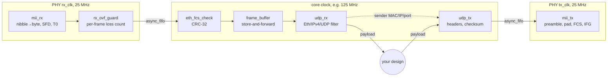

# fpga-eth-core: a payload-agnostic 10/100 Ethernet MAC and UDP stack for 7-series FPGAs

A small, verified Ethernet core in SystemVerilog. It turns MII nibbles from a 10/100 PHY
into UDP payloads in your clock domain, and sends UDP payloads back out the same way.
It knows nothing above the UDP payload interface. Three projects consume it as a git
submodule at release tags:
- [fpga-itch-orderbook](https://github.com/RodeanAzari/fpga-itch-orderbook) (P2, NASDAQ
  ITCH order book; owner of this repo)
- CCSDS satellite telemetry receiver (P3, IQ replay)
- SerDes lab (P4, stats and sample streaming)

**Status:** RX and TX paths are complete and verified in simulation, and both example
designs build in Vivado with timing met at 125 MHz. The RX hardware gate passed on
2026-11-05: 10 minutes at 98.4 Mbit/s with zero drops ([evidence](data/results/2026-11-05_v0.1_rx_stats_sustained.md)). The TX
gate followed: 9,000,000 echoes of 1–1,472 B, every one intact, at 96.3 Mbit/s each way
([evidence](data/results/2026-11-05_v0.2_udp_echo_sustained.md)). Released: `eth-core-v0.1` (RX) and `eth-core-v0.2` (TX).

Every number below comes from a committed report in [`docs/reports/`](docs/reports/),
produced by `make example` / `make example-echo`, or from a test run by `make ci`.
`[TBD]` means not measured yet.

## At a glance

| | |
|---|---|
| **Target** | Xilinx 7-series; built and timed on the Arty A7-100T (`xc7a100tcsg324-1`), TI DP83848J PHY |
| **PHY interface** | MII, 25 MHz nibble clocks, low nibble first; documented boundary, nothing PHY-specific beyond it |
| **RX** | MII → SFD hunt → async FIFO → FCS check → store-and-forward → Eth/IPv4/UDP filter → payload |
| **TX** | payload → UDP/IPv4/Ethernet header → async FIFO → padding, FCS, IFG → MII |
| **User interface** | Byte-wide AXI4-Stream with backpressure on both paths; runtime group/port/MAC/IP registers |
| **Host learning** | Reply MAC/IP/port latched from received datagrams, so no ARP |
| **Timing** | Met at 125 MHz: `udp_echo` WNS +0.312 ns, `rx_stats` WNS +0.348 ns ([reports](docs/reports/)) |
| **MII I/O margin** | RX input setup +6.299 ns, TX output setup +20.645 ns, vs. DP83848 datasheet SNLS250E |
| **Cost (RX + TX)** | 858 LUT, 1,323 FF, 2 RAMB36 + 2 RAMB18 (3 BRAM36 tiles); per block [below](#resource-cost) |
| **Formal** | `async_fifo`: k-induction PASS at depth 24 (no overflow/underflow, Gray, data integrity) |
| **Simulation** | 21 cocotb tests (26 runs across parameter sets), each new test shown to fail on a planted bug |
| **Hardware RX** | 4,880,000 / 4,880,000 datagrams, 0 errors, FIFO high-water 1 B; 610 s at 98.4 Mbit/s ([evidence](data/results/2026-11-05_v0.1_rx_stats_sustained.md)) |
| **Hardware TX** | 9,000,000 / 9,000,000 echoes intact, lengths 1–1,472 B, 0 underruns; 600 s at 96.3 Mbit/s each way ([evidence](data/results/2026-11-05_v0.2_udp_echo_sustained.md)) |
| **CI** | `make ci` locally: lint (zero warnings), formal, sim, host loopback tests |

## Architecture



- **Three clock domains:** the PHY's rx_clk, the PHY's tx_clk and your core clock. The
  only crossings are two Gray-pointer async FIFOs and one toggle synchronizer (the TX
  underrun flag), each constrained in XDC.
- **Store-and-forward on RX:** a frame reaches `udp_rx` only after its FCS checks, so
  no byte of a bad frame ever leaves the core.
- **Store-and-forward on TX:** `udp_tx` buffers a whole payload before sending, because
  the MII cannot be stalled mid-frame.
- **Fail loud:** every frame with an SFD gets exactly one status pulse (ok, CRC, PHY
  error, runt, oversize, FIFO overflow, filtered, checksum, malformed), so
  sent = sum of the counters. Nothing is dropped silently.

| Block | File | What it does | Verified by |
|---|---|---|---|
| Async FIFO | `rtl/async_fifo.sv` | Dual-clock, Gray pointers, block RAM, FWFT | `make formal` (k-induction), `make sim` |
| MII RX | `rtl/mii_rx.sv` | Nibble→byte, low nibble first, SFD, `sfd_o` T0 pulse | `make sim` |
| CRC-32 | `rtl/crc32_d8.sv` | Reflected 802.3 CRC, one byte per cycle | `make sim` (zlib reference) |
| FCS check | `rtl/eth_fcs_check.sv` | Residue check, FCS strip, one status per frame | `make sim` |
| Overflow guard | `rtl/rx_ovf_guard.sv` | Drops a frame that lost a byte, counts lost frames | `make sim` (via `eth_rx`) |
| Frame buffer | `rtl/frame_buffer.sv` | Releases only good frames; rewinds bad ones | `make sim` (via `eth_rx`) |
| **RX top** | `rtl/eth_rx.sv` | MII → good frames in the core domain | `make sim`, MII-level frames, forced overflow |
| UDP RX | `rtl/udp_rx.sv` | Eth/IPv4/UDP filter, runtime group/port, padding strip | `make sim` vs. independent RFC parser |
| MII TX | `rtl/mii_tx.sv` | Preamble, padding, FCS, exact IFG, underrun → bad FCS | `make sim` vs. zlib wire image |
| **TX top** | `rtl/eth_tx.sv` | Core-domain frames → MII | `make sim` (via `udp_echo`) |
| UDP TX | `rtl/udp_tx.sv` | Payload → full frame, length from tlast, RFC 791 checksum | `make sim` vs. independent RFC parser |

## Consumer guide

### Files and constraints

Add every file in `rtl/` to your build. For constraints:
- Read `constr/async_fifo.xdc` scoped to the FIFO: `read_xdc -ref async_fifo constr/async_fifo.xdc`.
  It bounds the Gray-pointer crossings.
- Write your own clocks, pins and MII I/O delays. [`constr/udp_echo_timing.xdc`](constr/udp_echo_timing.xdc)
  is a complete, commented example for the Arty A7 and DP83848.
- If you use the TX underrun flag, add its toggle-synchronizer max-delay, also shown there.

### Clocks

| Clock | Source | Used by | Requirement |
|---|---|---|---|
| Core (`clk_i`) | Yours, e.g. MMCM | Everything after the FIFOs | Faster than the 12.5 MB/s byte rate; built and timed at 125 MHz |
| `mii_clk_i` of `eth_rx` | PHY `RX_CLK` pin | `mii_rx`, guard, FIFO write | 25 MHz at 100 Mb/s |
| `mii_clk_i` of `eth_tx` | PHY `TX_CLK` pin | FIFO read, `mii_tx` | 25 MHz at 100 Mb/s |
| PHY reference | Yours | The PHY | The Arty's PHY has **no crystal**: the FPGA must drive 25 MHz on `eth_ref_clk`, or the link never comes up. `examples/rx_stats/xilinx/clk_gen.sv` forwards it through an ODDR. |

### Resets

Each domain takes a synchronous, active-high reset from its own reset synchronizer,
and all of them are fed by the same source. Both sides of an async FIFO must be in reset
together. Hold the MAC in reset until the PHY clocks are running, because a domain whose
clock is absent cannot leave reset. The examples release the PHY reset at 10 ms and the
MAC at 200 ms after the MMCM locks (`examples/udp_echo/udp_echo_top.sv`,
`examples/rx_stats/reset_sync.sv`).

### Receive: `eth_rx` + `udp_rx`

Connect `eth_rx.m_*` to `udp_rx.s_*` (byte-wide AXI-Stream, one frame per tlast). Then:

| `udp_rx` port | Direction | Meaning |
|---|---|---|
| `cfg_mac_i`, `cfg_ip_i`, `cfg_port_i` | in | Runtime filter. A class-D `cfg_ip_i` selects multicast (MAC derived per RFC 1112); otherwise `cfg_mac_i` must match. Change between frames only. |
| `m_tdata_o`, `m_tvalid_o`, `m_tready_i`, `m_tlast_o` | out/in | One UDP payload per tlast, Ethernet padding removed, backpressure honoured |
| `m_tuser_o` | out | On tlast: the datagram was truncated; discard it |
| `src_mac_o`, `src_ip_o`, `src_port_o`, `dst_port_o` | out | Sender of the current datagram, stable from its first payload beat; feed them to `udp_tx` to reply |
| `ok_o`, `filtered_o`, `ip_csum_err_o`, `malformed_o` | out | One pulse per frame |

`eth_rx` status pulses: `frame_ok_o`, `crc_err_o`, `rx_err_o`, `runt_o`, `oversize_o`,
`ovf_o` with `ovf_frames_o` (frames lost to FIFO overflow). `fifo_level_o` gives a
high-water mark, and `sfd_o` is the T0 timestamp event in the rx_clk domain.

**Backpressure:** the MII cannot be stalled. If your design holds `m_tready_i` low long
enough to fill the 4 KB frame buffer and then the 2 KB FIFO, frames are lost. Every loss
is counted in `ovf_frames_o`, and no partial frame is ever delivered.

### Transmit: `udp_tx` + `eth_tx`

Connect `udp_tx.m_*` to `eth_tx.s_*`. Then:

| `udp_tx` port | Direction | Meaning |
|---|---|---|
| `cfg_mac_i`, `cfg_ip_i` | in | This node's source MAC and IP |
| `s_tdata_i`, `s_tvalid_i`, `s_tready_o`, `s_tlast_i` | in/out | One payload per tlast, 1–1,472 bytes. **No length input:** it is counted from tlast. |
| `s_tuser_i` | in | On tlast: discard this payload (send nothing) |
| `dst_mac_i`, `dst_ip_i`, `dst_port_i`, `src_port_i` | in | Sampled with the first payload beat |
| `sent_o`, `oversize_o` | out | Frame sent; payload > 1,472 B dropped |

`eth_tx.underrun_o` pulses if a frame starved the MII. That frame goes out with a wrong
FCS, so no receiver accepts it. With `udp_tx` in front it cannot happen, because frames
leave `udp_tx` at one byte per cycle without gaps. If you drive `eth_tx` directly, each
frame must arrive without long gaps once its first byte is accepted.

### A minimal top level

[`examples/udp_echo/udp_echo_top.sv`](examples/udp_echo/udp_echo_top.sv) is the complete
reference: clocks, reset sequencing, RX, TX, counters over UART. The datapath part is
just this:

```systemverilog
eth_rx u_eth_rx (.mii_clk_i(eth_rx_clk), .mii_rst_i(mii_rx_rst), .mii_rxd_i(eth_rxd),
                 .mii_rx_dv_i(eth_rx_dv), .mii_rx_er_i(eth_rxerr), .clk_i(clk), .rst_i(rst),
                 .m_tdata_o(f_tdata), .m_tvalid_o(f_tvalid), .m_tready_i(f_tready),
                 .m_tlast_o(f_tlast), /* status outputs */ ...);

udp_rx u_udp_rx (.clk_i(clk), .rst_i(rst), .cfg_mac_i(OWN_MAC), .cfg_ip_i(GROUP_IP),
                 .cfg_port_i(UDP_PORT), .s_tdata_i(f_tdata), .s_tvalid_i(f_tvalid),
                 .s_tready_o(f_tready), .s_tlast_i(f_tlast),
                 .m_tdata_o(rx_tdata), .m_tvalid_o(rx_tvalid), .m_tready_i(rx_tready),
                 .m_tlast_o(rx_tlast), .m_tuser_o(rx_tuser),
                 .src_mac_o(peer_mac), .src_ip_o(peer_ip), .src_port_o(peer_port), ...);

// Your design consumes rx_* and produces tx_* here. The echo example wires them together.

udp_tx u_udp_tx (.clk_i(clk), .rst_i(rst), .cfg_mac_i(OWN_MAC), .cfg_ip_i(OWN_IP),
                 .s_tdata_i(tx_tdata), .s_tvalid_i(tx_tvalid), .s_tready_o(tx_tready),
                 .s_tlast_i(tx_tlast), .s_tuser_i(1'b0),
                 .dst_mac_i(peer_mac), .dst_ip_i(peer_ip), .dst_port_i(peer_port),
                 .src_port_i(UDP_PORT), .m_tdata_o(t_tdata), .m_tvalid_o(t_tvalid),
                 .m_tready_i(t_tready), .m_tlast_o(t_tlast), ...);

eth_tx u_eth_tx (.clk_i(clk), .rst_i(rst), .s_tdata_i(t_tdata), .s_tvalid_i(t_tvalid),
                 .s_tready_o(t_tready), .s_tlast_i(t_tlast), .underrun_o(tx_underrun),
                 .mii_clk_i(eth_tx_clk), .mii_rst_i(mii_tx_rst),
                 .mii_txd_o(eth_txd), .mii_tx_en_o(eth_tx_en));
```

### Latency

| Stage | Cycles | Source |
|---|---|---|
| `mii_rx`: SFD nibble → `sfd_o` | 2 rx_clk | `rtl/mii_rx.sv` header |
| Async FIFO | SYNC_STAGES + 1 read-side cycles (+ ≤ 1 for phase) | `rtl/async_fifo.sv` |
| `frame_buffer`: last byte in → first byte out | 2 core | `rtl/frame_buffer.sv` |
| `udp_rx`: input byte → output beat | 1 core | `rtl/udp_rx.sv` |
| `udp_tx`: tlast in → first header byte out | 3 core | `rtl/udp_tx.sv` |
| `mii_tx`: first byte valid → tx_en | 2 tx_clk, then 16 nibbles of preamble/SFD | `rtl/mii_tx.sv` |

Both directions are store-and-forward. At 100 Mb/s, serialization dominates: one
1,472-byte payload is about 123 µs on the wire.

### Resource cost

Post-route, `udp_echo` on `xc7a100tcsg324-1`, Vivado 2025.2
([utilization_hier.rpt](docs/reports/udp_echo/utilization_hier.rpt)):

| Block | LUT | FF | Block RAM |
|---|---|---|---|
| `eth_rx` (incl. 2 KB FIFO, 4 KB frame buffer) | 235 | 273 | 2 × RAMB36 |
| `udp_rx` | 216 | 453 | — |
| `udp_tx` (1,472 B payload buffer) | 277 | 429 | 1 × RAMB18 |
| `eth_tx` (2 KB FIFO) | 130 | 168 | 1 × RAMB18 |
| **RX + TX total** | **858** | **1,323** | 2 × RAMB36 + 2 × RAMB18 |

`async_fifo` always uses block RAM (one BRAM18 minimum), so its Gray pointers are its
only clock-domain crossing. See the CHANGELOG for why.

## Verification, by layer

| Layer | What runs | Result |
|---|---|---|
| **Formal** (`make formal`) | `async_fifo`, SymbiYosys k-induction at depth 24 on a depth-4 instance, two free-running clocks | PASS. Proven: no overflow or underflow, Gray encoding, synchronizer monotonicity, data integrity of an arbitrary tagged word. Three planted bugs each fail the proof. |
| **cocotb** (`make sim`) | 21 tests, 26 runs across parameter sets, Verilator 5.050, seeds logged and replayable | All pass. Frames from MII nibbles to payloads and back; every status count exact; an independent RFC parser judges RX and TX. |
| **End to end** | `examples/udp_echo` in sim: MII pins in, MII pins out | 120 echoes of 1–1,472 B byte-exact to 4 rotating senders; foreign and bad-FCS frames not echoed; UART counters exact |
| **Host tools** (`make host-test`) | `udp_seq_send` and `udp_echo_check` over loopback | Every datagram checked; injected drop and corruption reported exactly; late echoes not miscounted as lost |
| **Hardware** | `rx_stats` on the Arty, 100 Mbit/s full duplex | 610 s at 8,000 datagrams/s: every datagram delivered byte-exact, every error counter 0 ([evidence](data/results/2026-11-05_v0.1_rx_stats_sustained.md)); `udp_echo` 600 s at 15,000 datagrams/s, 1–1,472 B: 9,000,000 echoes intact ([evidence](data/results/2026-11-05_v0.2_udp_echo_sustained.md)) |

Testbenches use [tb-common](https://github.com/RodeanAzari/tb-common) (AXI-Stream
driver/monitor, in-order scoreboard, seeded RNG) at tag `tb-common-v0.1`.

**Planted bugs.** Every new test was first shown to fail on a deliberate bug:
- **RX:** reversed nibble order, wrong CRC residue, buffer releasing bad frames, guard
  undercounting lost frames, checksum ignored, padding leak, 24-bit multicast mapping
  (only visible with a group whose bit 23 is set), swapped counter wiring.
- **TX:** high nibble first, IFG one short, FCS not spoiled on underrun, padding to 59,
  destination sampled at tlast, single-fold checksum, UDP length off by one, oversize not
  counted.

### Bugs found

1. **Gray register declared after use** (`async_fifo`). Found by Vivado, not by
   Verilator or formal: Synth 8-6901 and an XDC filter that also matched LUT cells. Fixed
   by moving the declaration and limiting the filter to sequential cells.
2. **"Unsafe" clock crossings in the formally proven FIFO.** Found by Vivado's
   `report_clock_interaction` on the first TX build, which had met timing. Two causes:
   - The 64-deep TX FIFO had mapped to distributed RAM, whose asynchronous read makes
     the memory itself a crossing.
   - Synthesis had merged the Gray pointer's MSB into the identical binary MSB, moving
     the launch point out from under the constraint.

   Fixed by forcing block RAM and marking the Gray registers `DONT_TOUCH`.
3. **Checksum corner case invisible to random tests.** Found while writing the TX tests.
   A single-fold IPv4 checksum is wrong only when the first fold carries again, about
   1 in 10⁴ random headers. A directed test now forces that case, and the planted
   single-fold bug fails it.
4. **Host test assumed loopback preserves order.** Found by `make host-test` failing 4 of
   5 runs. WSL2 loopback reorders a few datagrams per 20,000, all of them present. The
   test now checks each sequence number arrives exactly once. The real-link senders are
   pinned with `taskset`, so a multi-queue NIC cannot reorder either.
5. **Testbench clock phase finer than 1 ps.** Found when cocotb rejected the clock.
   Phases are now drawn in whole picoseconds.

## Example designs

Both are non-ITCH top levels for the Arty A7-100T that use only the documented interface.

| Example | What it does | Hardware gate it runs | Vivado (125 MHz) |
|---|---|---|---|
| [`rx_stats`](examples/rx_stats/README.md) | Receives UDP, checks a sequence number, 15 counters over UART | `eth-core-v0.1`: ≥ 10 min sustained, zero drops, FIFO high-water mark | WNS +0.348 ns, 892 LUT, 2 BRAM36 |
| [`udp_echo`](examples/udp_echo/README.md) | Echoes each datagram to its sender (learned MAC/IP/port) | `eth-core-v0.2`: random lengths 1–1,472 B, every echo checked | WNS +0.312 ns, 1,119 LUT, 3 BRAM36 |

Host tools: `host/udp_seq_send` (paced sequence-number sender) and
`host/udp_echo_check` (random-length sender with a byte-exact echo checker), both C++20,
with a `key=value` summary for results files.

## Results

| Result | Value | Conditions | Source |
|---|---|---|---|
| Core timing, `udp_echo` | WNS +0.312 ns, WHS +0.060 ns | 125 MHz, Vivado 2025.2 | [timing_summary.rpt](docs/reports/udp_echo/timing_summary.rpt) |
| Core timing, `rx_stats` | WNS +0.348 ns, WHS +0.042 ns | same | [timing_summary.rpt](docs/reports/rx_stats/timing_summary.rpt) |
| MII RX input setup margin | +6.299 ns | DP83848 T2.5.2, RX_CLK→data 10–30 ns | same |
| MII TX output setup margin | +20.645 ns | DP83848 T2.4.2, 10 ns setup | [timing_summary.rpt](docs/reports/udp_echo/timing_summary.rpt) |
| Clock crossings | All "Max Delay Datapath Only", 0 critical warnings | both examples | [clock_interaction.rpt](docs/reports/udp_echo/clock_interaction.rpt) |
| Sustained RX, zero drops | 4,880,000 sent, 4,880,000 delivered, `ovf_lost` 0 | 610 s, 1,472 B payloads, 8,000/s = 98.4 Mbit/s on the wire | [CSV](data/results/2026-11-05_v0.1_rx_stats_sustained.csv), [notes](data/results/2026-11-05_v0.1_rx_stats_sustained.md) |
| RX FIFO high-water mark | 1 byte of 2,048 (core-side view, may read 2–3 low) | same run | same |
| TX echo, 1–1,472 B | 9,000,000 sent, 9,000,000 intact, 0 lost; every length ≥ 5,782 times | 600 s, 15,000/s = 96.3 Mbit/s each way, full duplex | [CSV](data/results/2026-11-05_v0.2_udp_echo_sustained.csv), [notes](data/results/2026-11-05_v0.2_udp_echo_sustained.md) |

## Limitations

- **10/100 MII only.** There is no GMII/RGMII, and no transceiver-based PHY. The MII
  boundary is documented so another PCS can sit underneath, but none exists yet.
- **Byte-wide datapath.** One byte per core cycle is ample for 100 Mb/s, but the core
  would need widening for faster links.
- **No ARP, ICMP, VLAN, IP fragments or IPv4 options on TX.** The reply address is
  learned from received datagrams, so a host must speak first. RX skips IPv4 options and
  rejects fragments and VLAN-tagged frames.
- **UDP checksum is not checked on RX and is sent as 0 on TX.** Both are allowed in
  IPv4.
- **One payload buffered on TX.** `udp_tx` cannot accept the next payload until the
  current frame has left it. That keeps up with line rate but limits burst absorption.
- **The FIFO high-water mark is for steady streaming.** `rx_stats` never backpressures
  `udp_rx`, so the 1-byte mark says nothing about a consumer that stalls.
- **The test host reorders ~0.08% of datagrams** (Windows I225-LM driver, shown by
  pktmon). None are lost, but `rx_stats`'s sequence check counts them, and a consumer
  that needs order must use a host path that preserves it.
- **Bad-FCS frames from the host** are only tested in simulation. NIC support for
  sending them (`SO_NOFCS`) has not been checked.

## Build and reproduce

Linux or WSL2. Verilator ≥ 5.036 (5.050 used), oss-cad-suite (Yosys, SymbiYosys), Python
≥ 3.11 with `pip install -r requirements.txt` (cocotb 2.1, tb-common at its tag), CMake
and a C++20 compiler. Vivado ML Standard 2025.2 for the example builds.

| Target | Does | Runs where |
|---|---|---|
| `make lint` | `verilator --lint-only -Wall` on every module and both example tops, zero warnings | local |
| `make formal` | SymbiYosys proof and cover of `async_fifo` | local |
| `make sim` | All cocotb tests (`tb/run.py [test_module ...]` runs a subset) | local |
| `make host`, `make host-test` | Build the C++ host tools; loopback tests | local |
| `make ci` | lint + formal + sim + host-test | local (about 13 minutes) |
| `make example` | Vivado batch build of `rx_stats`; reports to `docs/reports/rx_stats/` | local, needs Vivado |
| `make example-echo` | Same for `udp_echo` | local, needs Vivado |
| `make clean` | Remove build output | local |

The Vivado builds refuse to write a bitstream unless setup and hold are met and no
critical CDC violation exists.

## Repository layout

| Path | Contents |
|---|---|
| `rtl/` | The core: synthesizable SystemVerilog only, one module per file |
| `constr/` | Arty pins (copied by script from Digilent's master XDC), example timing, scoped `async_fifo.xdc` |
| `examples/` | `rx_stats` and `udp_echo` top levels, with the Xilinx primitive wrappers in `xilinx/` |
| `tb/` | cocotb tests, Ethernet helpers (`eth.py`: MII driver/monitor, frame builder), simulation models of Xilinx primitives |
| `formal/` | SymbiYosys setup and properties for `async_fifo` |
| `host/` | C++20 host tools and their loopback tests |
| `syn/` | Vivado batch build script |
| `docs/reports/` | Committed Vivado reports per example |
| `CHANGELOG.md` | Every change, and every release with its gate test and evidence |

## Roadmap

- **`eth-core-v0.1`:** link up on the Arty, then `rx_stats` for ≥ 10 minutes at the
  highest sustained rate with zero drops, and report the FIFO high-water mark.
- **`eth-core-v0.2`:** `udp_echo` on hardware with random payloads of 1–1,472 B, every
  echo checked.
- After that: changes only through requests from consuming projects, each a new tag
  with a CHANGELOG note on what consumers must change.

## License

MIT, see [LICENSE](LICENSE).
